# DataBug

A fast, memory-light, free and open source database client written in Rust for macOS, Windows and Linux, with a DataGrip-style workflow (DataBug isn't affiliated with JetBrains; see [Disclaimer](#disclaimer)): a schema explorer that shows every kind of object, a SQL editor that understands your schema, a virtualized results grid, query plans, table and routine editing, schema compare, ER diagrams, CSV import, rename refactoring, and guard rails for production.

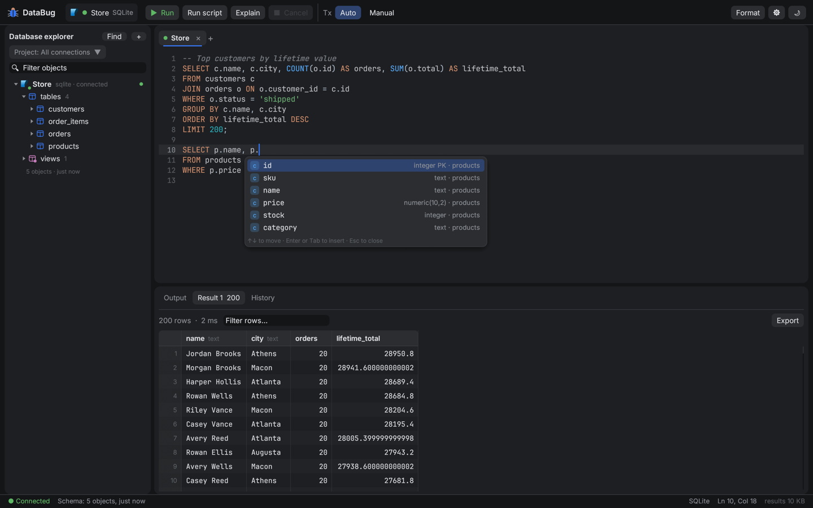

| Several databases per server, projects, disconnected connections | Find and replace (`Ctrl/⌘ + F`) | Six themes and custom colors |
|---|---|---|
| 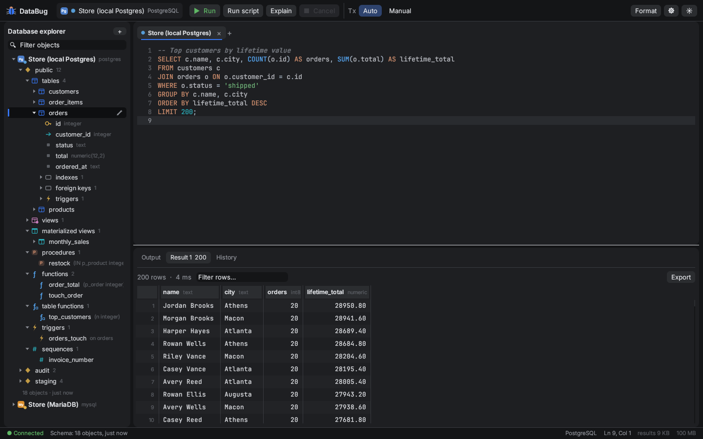 | 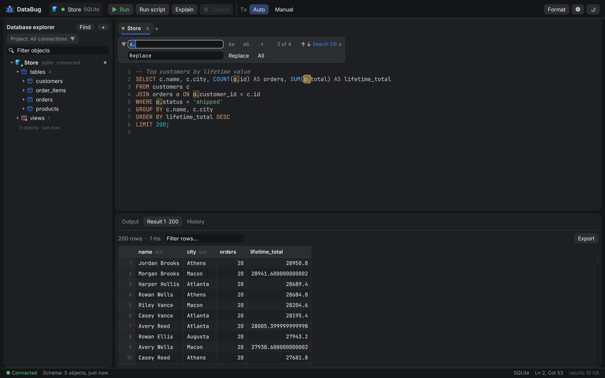 | 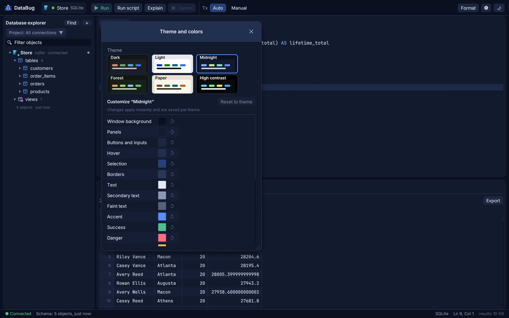 |

| Schema compare with migration DDL | ER diagram | Modify table |
|---|---|---|
| 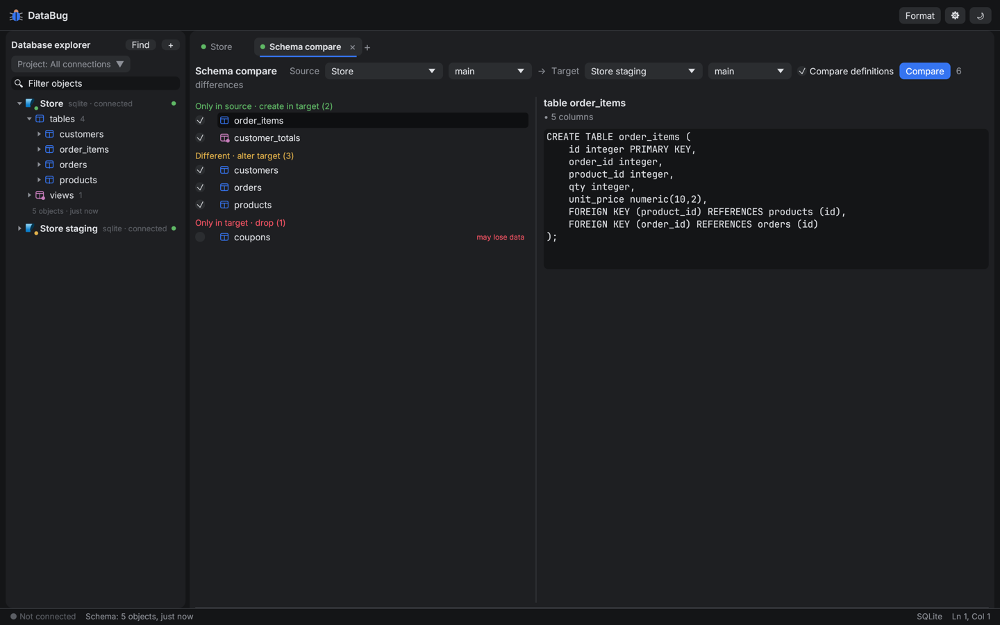 | 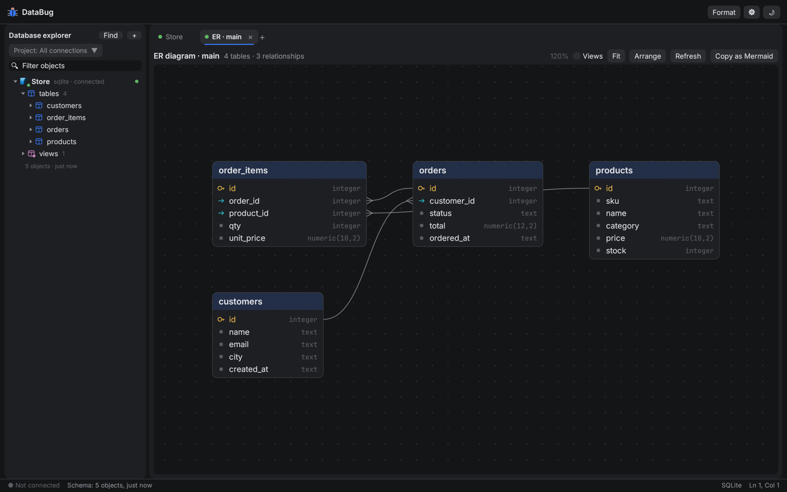 | 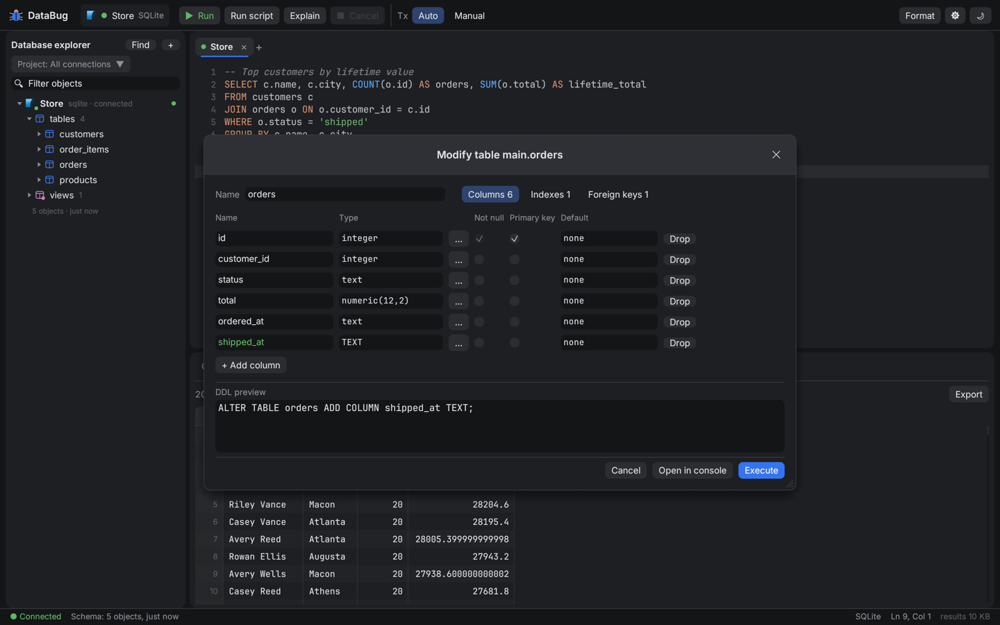 |

| CSV import | Rename refactoring | Query plan |
|---|---|---|
| 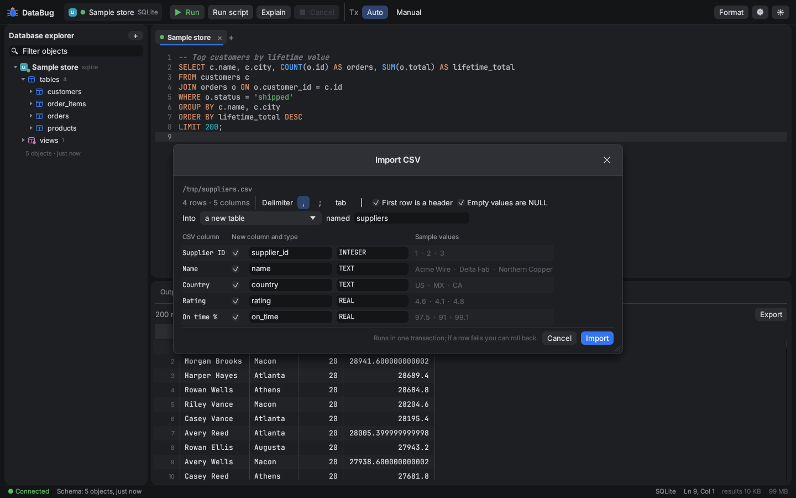 | 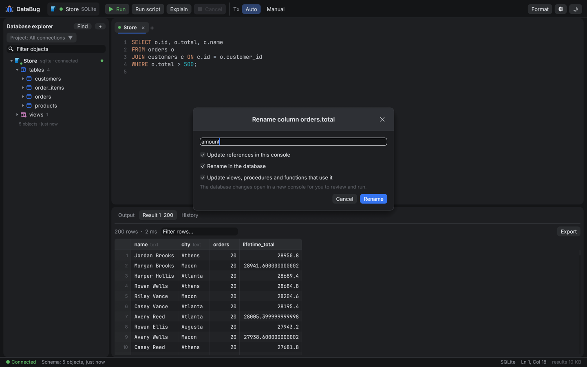 | 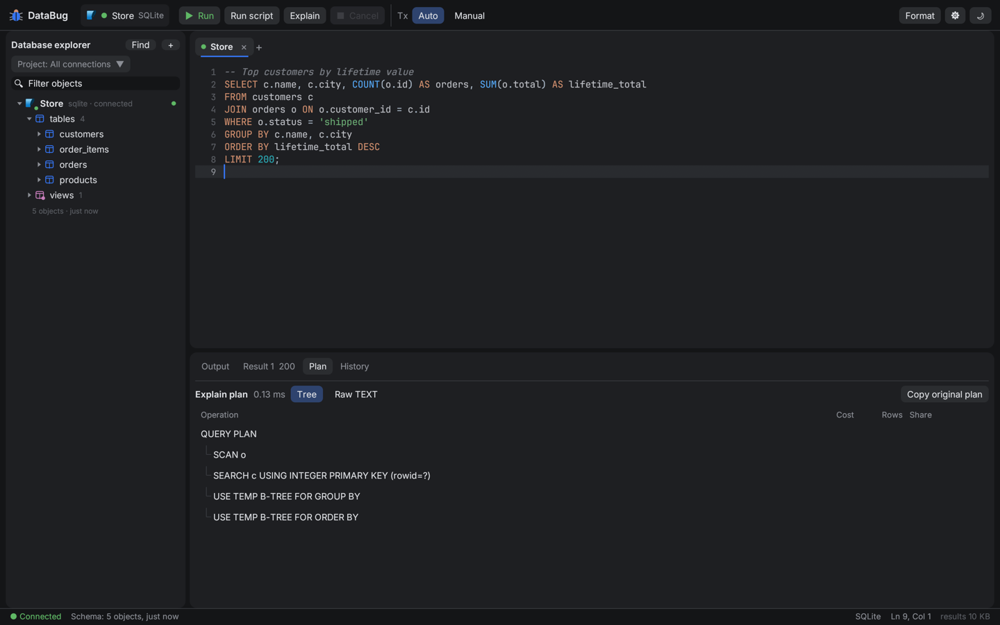 |

| Connection dialog | Light theme | |
|---|---|---|
| 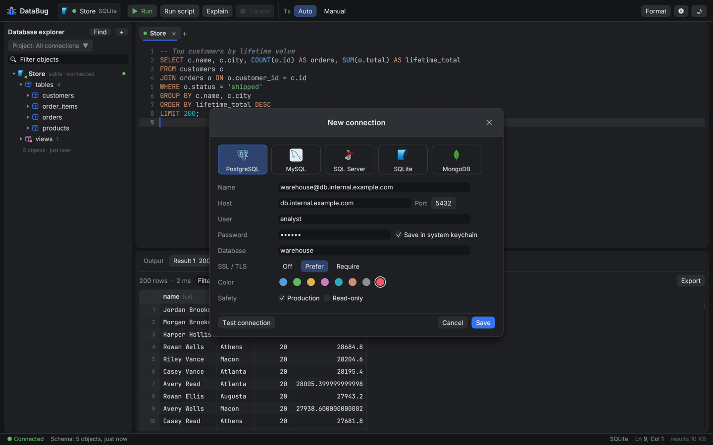 | 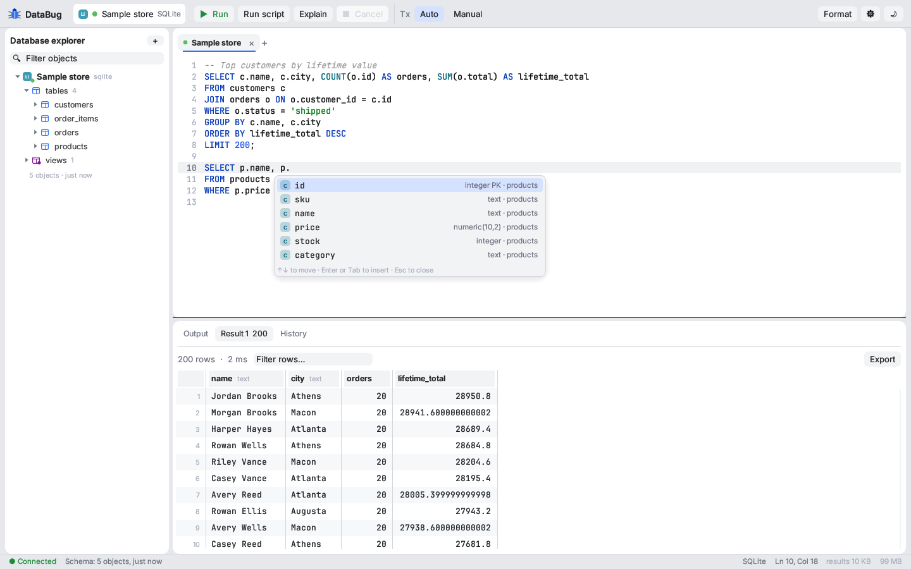 | |

## Install

| Platform | Installer | One-line install |
|---|---|---|
| **macOS** (Apple silicon and Intel) | `DataBug-macos-universal.dmg`: open it and drag DataBug to Applications | `curl -fsSL https://raw.githubusercontent.com/hayes-roach/DataBug/main/install.sh \| sh` |
| **Windows** 10/11 (x64) | `DataBug-windows-x86_64-setup.exe`: installs for your user (no admin needed), adds Start menu and optional desktop shortcuts, uninstall from Settings → Apps | `irm https://raw.githubusercontent.com/hayes-roach/DataBug/main/install.ps1 \| iex` (PowerShell) |
| **Linux** (x86_64) | `DataBug-linux-x86_64.tar.gz`: extract and run `DataBug/install.sh` (app, icon and menu entry in `~/.local`) | `curl -fsSL https://raw.githubusercontent.com/hayes-roach/DataBug/main/install.sh \| sh` |

Download the installers from the [latest release](https://github.com/hayes-roach/DataBug/releases/latest). Running a one-line install again updates an existing install in place (it says "Updating 0.1.0 → 0.2.0", or "already up to date" and stops; add `-s -- --force` after `sh` to reinstall anyway). To uninstall: drag DataBug.app to the Trash on macOS, use Settings → Apps on Windows, or run `install.sh --uninstall` (either script) on macOS/Linux. Settings and history are kept.

The apps aren't signed with a paid Apple or Microsoft certificate yet. On macOS, if Gatekeeper blocks the first launch of the DMG install, right-click DataBug in Applications → *Open* (the one-line installer avoids this). On Windows, SmartScreen may show "Windows protected your PC": click *More info* → *Run anyway*.

### Updates

DataBug checks GitHub for a newer release when it starts (at most every 6 hours) and once a day while it's open. When one is out, an **Update to X.Y.Z** button appears in the toolbar. Nothing changes until you click it:

- **Update and restart** downloads the new version for your platform, checks it against the release's `SHA256SUMS.txt` (a damaged or altered download is refused and nothing is installed), installs it and reopens DataBug. Connections, settings, passwords and history are kept.
  - macOS: replaces `DataBug.app` where it is (it needs to be in a folder you can write to, like Applications)
  - Windows: runs the new setup silently over the existing install (per-user or all-users, whichever you have)
  - Linux: reruns the new release's `install.sh` into `~/.local`
- **Skip this version** stops reminders for that release; **Later** hides the window until next time.
- Copies DataBug can't replace itself (a build from source, the portable Windows zip, or a Linux binary not installed with `install.sh`) still get the notice, with a link to the release or, for source builds, `git pull && cargo build --release`.
- *Settings (⚙) → Check for updates automatically* turns the checks off; *Check for updates* checks right away. The check is a single request to GitHub's public releases API and sends nothing about you or your databases. Downloads use the system `curl`.

### Making a release

Push a tag like `v0.2.0`; `.github/workflows/release.yml` builds the DMG, setup .exe, portable Windows zip and Linux tarball, adds `SHA256SUMS.txt`, and publishes a GitHub release with install instructions. Every push to `main` also uploads the macOS and Windows installers as CI artifacts.

To build installers yourself:
- macOS: `packaging/macos/bundle.sh` (this Mac's architecture) or `packaging/macos/bundle.sh universal` → `dist/DataBug-macos-*.dmg` and `.zip`
- Windows: `cargo build --release`, then `iscc packaging\windows\databug.iss` with [Inno Setup 6](https://jrsoftware.org/isinfo.php) → `dist\DataBug-windows-x86_64-setup.exe`
- Linux: `cargo build --release`, then copy `target/release/databug` next to `packaging/linux/install.sh` and run it

The in-app updater reads the latest GitHub release, so every release must include the platform assets under their usual names and `SHA256SUMS.txt` (the release workflow does this).

## Databases

| Engine | Driver crate | Queries and results | Schema introspection | Explain | Server-side cancel | Tested against a live server |
|---|---|---|---|---|---|---|
| PostgreSQL | `tokio-postgres` | ✔ | ✔ (pg_catalog) | JSON tree, `ANALYZE` | ✔ | ✔ Postgres 16 |
| MySQL / MariaDB | `mysql_async` | ✔ | ✔ (information_schema) | JSON tree, `ANALYZE` text | ✔ (`KILL QUERY`) | ✔ MariaDB 10.11 |
| SQLite | `rusqlite` (bundled) | ✔ | ✔ | `EXPLAIN QUERY PLAN` tree | ✔ (interrupt) | ✔ |
| SQL Server | `tiberius` | ✔ | ✔ (sys catalog) | Showplan XML tree | drops connection | ✔ live server |
| MongoDB | `mongodb` | ✔ shell syntax | ✔ (sampled fields) | `explain` tree | drops connection | compiles, not yet run against a server |
| CockroachDB | `tokio-postgres` (PostgreSQL protocol) | ✔ | ✔ (information_schema) | text (`EXPLAIN (VERBOSE)`, `ANALYZE`) | ✔ | ✔ CockroachDB 24.3 (Docker) |
| TimescaleDB | `tokio-postgres` (PostgreSQL protocol) | ✔ | ✔ (pg_catalog; chunks hidden, continuous aggregates as materialized views) | JSON tree, `ANALYZE` | ✔ | ✔ TimescaleDB on Postgres 16 (Docker) |
| QuestDB | `tokio-postgres` (PostgreSQL protocol, port 8812) | ✔ | ✔ (`SHOW TABLES` / `SHOW COLUMNS`) | text | drops connection | ✔ QuestDB (Docker, latest) |
| H2 | `tokio-postgres` (H2's `-pg` server mode) | ✔ | ✔ (information_schema) | text, `ANALYZE` | drops connection | ✔ H2 2.3.232 (`-pg`) |
| DuckDB | official `libduckdb` 1.5.6, downloaded on demand and loaded at run time | ✔ | ✔ (information_schema, macros, sequences) | text, `ANALYZE` | ✔ (interrupt) | ✔ DuckDB 1.5.6 |
| Apache Cassandra | `scylla` | ✔ CQL | ✔ (system_schema; keyspaces as schemas) | — | drops connection | ✔ Cassandra 5 (Docker) |
| CouchDB | `reqwest` (HTTP API) | ✔ Mango in shell syntax | ✔ (databases as collections, sampled fields, indexes) | `_explain` JSON | drops connection | ✔ CouchDB 3 (Docker) |
| InfluxDB | `reqwest` (HTTP API) | ✔ InfluxQL, Flux (2.x), line-protocol `INSERT` | ✔ (measurements, tags, fields) | — | drops connection | ✔ InfluxDB 2.7 (Docker) |
| Oracle | `oracle` (ODPI-C; needs Oracle Instant Client at run time) | ✔ | ✔ (ALL_* views) | `DBMS_XPLAN` text | ✔ (break) | compiles, not yet run against a server |
| IBM Db2 | `odbc-api` (needs unixODBC + IBM Db2 ODBC driver) | ✔ | ✔ (SYSCAT) | — | drops connection | compiles, not yet run against a server |
| Spark SQL | `odbc-api` (Thrift server through a Spark ODBC driver) | ✔ | ✔ (`SHOW` / `DESCRIBE`) | `EXPLAIN FORMATTED` text | drops connection | compiles, not yet run against a server |

The new-connection dialog groups engines by type: **Relational / SQL** (PostgreSQL, MySQL, SQL Server, SQLite, Oracle, Db2, H2), **Analytical** (DuckDB), **NoSQL · Document** (MongoDB, CouchDB), **NoSQL · Wide-column** (Cassandra), **Time series** (TimescaleDB, QuestDB, InfluxDB) and **Big data / distributed** (CockroachDB, Spark SQL).

### What the explorer shows

| | PostgreSQL | MySQL / MariaDB | SQL Server | SQLite | MongoDB |
|---|---|---|---|---|---|
| Tables, columns, keys, indexes, foreign keys | ✔ | ✔ | ✔ | ✔ | collections, sampled fields, indexes |
| Views | ✔ | ✔ | ✔ | ✔ | ✔ |
| Materialized views | ✔ | | | | |
| Stored procedures | ✔ | ✔ | ✔ | | |
| Functions (scalar, table-valued, aggregates) | ✔ (with overloads) | ✔ | ✔ | | |
| Triggers | ✔ | ✔ | ✔ | ✔ | |
| Sequences | ✔ | | ✔ | | |
| Synonyms | | | ✔ | | |
| Events | | ✔ | | | |
| CLR procedures, functions, aggregates, triggers, assemblies | | | ✔ | | |

Every object with a definition has an **edit** button (the pencil that appears on hover or selection, also on double-click). Tables open the table editor. Views, materialized views, procedures, functions, triggers, sequences, synonyms and events open their definition as runnable DDL in a console: `CREATE OR REPLACE` on Postgres and MySQL views, `CREATE OR ALTER` on SQL Server (2016 SP1+), `DROP` + `CREATE` where the engine has no replace (MySQL routines, SQLite, Postgres materialized views). CLR objects open their `EXTERNAL NAME` binding, and assemblies show their details and the objects bound to them.

Each driver is a cargo feature (`postgres`, `mysql`, `mssql`, `sqlite`, `mongodb`, `cockroachdb`, `timescaledb`, `questdb`, `h2`, `duckdb`, `cassandra`, `couchdb`, `influxdb`, `oracle`, `db2`, `spark`), so a build can leave out the ones it doesn't need. Everything except `oracle`, `db2`, `spark` and `cassandra-tls` is in the default build and needs no system libraries. Those are opt-in because they need software DataBug can't bundle (`cassandra-tls` pulls in rustls' aws-lc backend, a C library):

| Feature | To build | To connect |
|---|---|---|
| `oracle` | nothing extra (ODPI-C is compiled in) | [Oracle Instant Client](https://www.oracle.com/database/technologies/instant-client.html) on the library path (`DYLD_LIBRARY_PATH` / `LD_LIBRARY_PATH` / `PATH`) or next to DataBug |
| `db2` | the ODBC driver manager: `brew install unixodbc` (macOS), `apt install unixodbc-dev` (Linux); built into Windows | the IBM Data Server Driver for ODBC and CLI, registered as `IBM DB2 ODBC DRIVER` (or set *ODBC driver* in the dialog) |
| `spark` | the ODBC driver manager, as for `db2` | a Spark ODBC driver (Simba or Databricks) and a running Spark Thrift server; *ODBC options* sets `ThriftTransport`, `HTTPPath` and friends |

```sh
cargo build --release --features databug-drivers/oracle
```

**DuckDB is downloaded, not built in.** Choosing DuckDB in the new-connection dialog offers **Download DuckDB**: DataBug fetches DuckDB's official library for your platform (about 36 MB on macOS, 41 MB on Linux, 13 MB on Windows) from [DuckDB's GitHub releases](https://github.com/duckdb/duckdb/releases/tag/v1.5.6) over verified HTTPS, checks it against a SHA-256 pinned in the source, keeps only the library (in DataBug's data folder under `runtimes/duckdb-1.5.6`) and loads it when you connect. Nothing is downloaded unless you click the button. To use a DuckDB library you already have, set `DATABUG_DUCKDB_LIB=/path/to/libduckdb.dylib` (`.so`, `duckdb.dll`).

Engines without a dialect of their own borrow the closest one for highlighting, completion and generated SQL: the PostgreSQL-compatible engines, Oracle, Db2, DuckDB, Cassandra and InfluxDB use the Postgres one (double-quoted identifiers), Spark SQL the MySQL one (backticks), and CouchDB the MongoDB shell syntax. Oracle gets `LIMIT n` rewritten to `FETCH FIRST n ROWS ONLY`. PL/SQL and SQL PL blocks with semicolons inside them aren't split correctly yet; run them as one selection.

CouchDB consoles take Mango queries in shell form: `db.orders.find({status: "open"}, {total: 1}).sort({total: -1}).limit(20)`, `findOne`, `countDocuments`, `insertOne/Many`, `createIndex`, `getIndexes`, `drop()`, `db.createCollection('name')`, `show dbs`, and `GET /path` for any read-only API call. Updates and deletes (which need the document's `_rev`) aren't supported yet. InfluxDB consoles take InfluxQL (`SHOW MEASUREMENTS`, `SELECT mean("total") FROM "orders" GROUP BY time(1h)`), Flux on 2.x (anything starting with `from(` or using `|>`; needs the organization) and `INSERT <line protocol>`; the API token goes in the password field. Cassandra (TLS needs the `cassandra-tls` feature), CouchDB, InfluxDB, Oracle, Db2 and Spark offer TLS *Off* or *Require* only: DataBug signs in once and never retries over the other transport. Cassandra connections all go through the host you enter (nodes often advertise internal addresses that aren't reachable through Docker, NAT or port-forwards); any node can coordinate a request.

MongoDB consoles accept shell-style statements: `db.orders.find({status: "open"}).sort({total: -1}).limit(20)`, `aggregate([...])`, `countDocuments`, `distinct`, `insertOne/Many`, `updateOne/Many`, `deleteOne/Many`, `createIndex`, `getIndexes`, `db.runCommand({...})`, `show collections`, `show dbs`. `ObjectId("…")` and `ISODate("…")` work inside filters.

### SQL Server sign-in

The connection dialog's **Authentication** row offers three options:

| Option | What you enter | Windows | macOS / Linux |
|---|---|---|---|
| SQL Server | login + password | ✔ | ✔ |
| Windows (current user) | nothing | ✔ SSPI, as the logged-in account | ✔ uses your Kerberos ticket (`kinit you@EXAMPLE.COM` first) |
| Windows credentials | `DOMAIN\user` or `user@example.com` + password | ✔ SSPI (NTLM or Kerberos) | ✔ DataBug runs `kinit` for that account, then signs in with the ticket |

On macOS and Linux, Windows sign-in is Kerberos only (no NTLM), so the machine needs a `krb5.conf` that knows your domain, and the **Host** must be the server's full DNS name (e.g. `sql01.example.com`), not an IP, so the `MSSQLSvc/` service name resolves. The release builds include Kerberos; when building yourself add `--features kerberos` (Linux needs `libkrb5-dev` / `krb5-devel` and clang). Passwords still go to the OS keychain, never the config file.

## Features

**Schema visibility** (like DataGrip's schema selection)
- Under each connection, a **"3 of 12 schemas"** chip opens a checklist with **All**, **Default only** and **Non-empty** shortcuts and a filter for long lists. Also in the connection's right-click menu (**Choose schemas…**) and in the connection dialog.
- The choice is saved per connection. Ticking every schema switches back to "All", which also picks up schemas created later. MySQL calls them databases.
- Hidden schemas are only hidden in the explorer; completion, compare and the ER diagram still see everything.

**Databases** (several per server, like schemas)
- PostgreSQL, SQL Server and MongoDB connections get a **"2 of 9 databases"** chip (also *Choose databases…* in the connection's menu). Tick databases to show each as its own node with its own schemas, schema picker, consoles and completion. *All* and *Default only* shortcuts.
- When a connection names no database, DataBug uses the default: `postgres` on PostgreSQL, the login's default database on SQL Server, `test` on MongoDB.

**Connections and projects**
- *Disconnect* (right-click a connection) closes its sessions but keeps it in the explorer; *Connect*, a double-click, or running a query reconnects. Connected connections show a green dot.
- Drag connections to reorder them.
- **No automatic retries after a failed sign-in.** When a connection can't sign in, DataBug shows the error and stops: no reconnecting in the background, no second attempt for queued work, so a wrong password can't lock the account. *Retry*, *Connect*, *Refresh schema*, running a query or editing the connection tries again.
- **Projects**: the switcher above the tree picks *All connections* or a project. Each project keeps its own ordered list of connections; new connections join the current project; right-click → *Add to project* / *Remove from project*. Saved in `projects.json`.

**Running procedures**
- Right-click a procedure → *Execute (EXEC)…* on SQL Server or *Execute (CALL)…* on PostgreSQL/MySQL; functions get *Run in console…* (`SELECT …`). Each parameter gets a `NULL` placeholder with its declared type as a comment; routines without parameters run immediately.
- Completion after `EXEC`, `EXECUTE` and `CALL` lists procedures with their parameters.

**Find**
- `Ctrl/⌘ + F` in the editor opens a find bar like VS Code's: match case (`Alt+C`), whole word (`Alt+W`), regex (`Alt+R`), "2 of 14", Enter / Shift+Enter or F3 / ⌘G to step, all matches highlighted. `Ctrl + H` (⌘⌥F on macOS) adds replace (one or all, `$1` groups with regex).
- **Find in database**: press `Ctrl/⌘ + F` again in the find bar, outside the editor, or use *Find* in the explorer. Searches object names, columns, and optionally the definitions of views, routines and triggers, in one connection or all of them. Click a result to reveal it in the explorer, double-click to open it. *Search table data…* generates a query that counts matching rows in every text column.

**Themes**
- Six built-in themes: Dark (default), Light, Midnight, Forest, Paper and High contrast, picked from the toolbar's theme menu. *Customize colors…* lets you change any of the 25 interface and syntax colors per theme, with per-color and whole-theme reset.

**Editor**
- Syntax highlighting per dialect, line numbers, current-line highlight, toggle comment (`Ctrl/⌘ + /`), formatter (`Ctrl + Alt + L`).
- Schema-aware completion that works on half-typed SQL: columns resolved through aliases (including aliases defined *after* the cursor), tables after `FROM`/`JOIN`, `schema.` drill-down, fuzzy matching (`cid` → `customer_id`), and join conditions after `ON` inferred from `<table>_id` naming.
- Inspections as you type: unknown tables, unknown `alias.column` references, `DELETE`/`UPDATE` without `WHERE`, `DROP`/`TRUNCATE`.
- Runs the statement under the cursor, the selection, or the whole script. The running statement is highlighted, and a failing statement is tinted red.

**Results**
- Virtualized grid (only visible rows are laid out), with column types in the header, click-to-sort (numeric and natural ordering), row filter, keyboard navigation, and copy cell/row.
- Row editing like DataGrip for single-table queries that include the primary key: double-click a cell (or F2) to edit it, click row numbers to select whole rows (⌘/Ctrl-click and Shift-click for several), *− Delete* or the Delete key to remove them, *+ Row* (Alt + Insert) to add one, *Duplicate* to copy one. Added, changed and deleted rows are color-coded and nothing is saved until *Submit*, which runs `DELETE`, `UPDATE` and `INSERT` statements keyed on the primary key (*Preview SQL* copies them, *Revert* undoes everything). If the database refuses a change, the pending edits stay so you can fix them.
- Streams rows in batches with a configurable row limit (default 10,000). Postgres cancels the rest of an over-limit result on the server instead of draining it.
- Export to CSV, JSON, SQL `INSERT`s or Markdown, or copy as TSV/CSV.
- Multiple result tabs per run, an Output log with timings, messages (Postgres `NOTICE`, MySQL warnings) and errors, and a searchable query history.

**Schema tools**
- **Modify table / New table**: edit columns (name, type, not null, primary key, default), indexes and foreign keys, with a live preview of the exact DDL for the engine. *Execute* runs it and reloads the schema; *Open in console* lets you review first. SQLite changes it can't make in place (types, keys, constraints) are done with a safe rebuild: create, copy, swap.
- **Schema compare**: pick any two connection + schema pairs. Lists what's only in the source, only in the target, or different (columns, types, nullability, defaults, keys, indexes, foreign keys, and optionally the text of views and routines). Each difference shows its DDL. Changes that can lose data are flagged and start unchecked. *Open migration in console* or *Run on target*.
- **ER diagrams**: tables and foreign keys with crow's-foot edges, auto-arranged by relationship, pan/zoom/drag, *Copy as Mermaid*, double-click a table to modify it.
- **CSV import**: into an existing table (columns matched by name, or mapped by hand) or a new table (column names cleaned up, types inferred). Delimiter auto-detected; runs in one transaction.
- **Rename refactoring** (`Shift + F6` on an identifier, or *Rename…* in the explorer): aliases are renamed throughout the statement; tables and columns are renamed in the console, and DataBug generates the `ALTER`/`sp_rename` plus rewritten definitions of every view, procedure and function that references them, for you to review and run.

**Plans**
- Explain and Explain Analyze render as a tree with time/cost bars. Selecting a node shows its details. *Copy original plan* gives you the plan in the engine's native JSON/XML/text. `EXPLAIN ANALYZE` of a write runs inside a transaction that's rolled back.

**Safety**
- Per-connection color, **Production** flag (red marker and a confirmation before anything that changes data), and **Read-only** flag (blocked in the client, and set at session level on Postgres, MySQL and SQLite).
- Confirmation for `DELETE`/`UPDATE` without `WHERE`, `DROP` and `TRUNCATE`.
- Manual transaction mode with an "open transaction" indicator and Commit/Rollback buttons.
- Cancel asks the server to stop the query. Pressing it again (or on engines without server cancel) drops and reopens the connection.

**Explorer**
- Connections → schemas → object groups → objects, with columns, indexes, foreign keys and triggers under each table, and filtering across all of them.
- The selected row gets a darker background with an accent bar.
- Engine logos ship with DataBug: they live in `crates/databug-app/assets/logos`, are compiled into the binary, and every release download includes them in a `logos` folder next to the application (next to `DataBug.exe` / `databug`; on macOS next to `DataBug.app`, and inside it). To swap one, replace `postgresql`, `mysql`, `sqlserver`, `sqlite`, `mongodb`, `couchdb`, `oracle`, `db2`, `duckdb`, `cassandra`, `cockroachdb`, `timescaledb`, `questdb`, `influxdb`, `spark` or `h2` (`.svg` or `.png`) in that folder and restart DataBug. The newer engines ship with DataBug's own monogram tiles rather than their official logos; [`SOURCES.md`](crates/databug-app/assets/logos/SOURCES.md) lists where each file comes from and its license. `mariadb.png` is included for later (MariaDB detection).

**Connections**
- Passwords go to the OS keychain (macOS Keychain, Windows Credential Manager, Secret Service on Linux), never into config files. If no keychain is available, they're kept in memory for the session.
- `connections.json` and `settings.json` are plain JSON with no secrets, so they can live in Git.
- TLS for Postgres (`prefer`/`require`, encrypt without verifying, like libpq), MySQL (`require`) and SQL Server (with an optional *trust server certificate*).

**Performance**
- Result cells live in one string arena per result with a `u32` offset and a null bit per cell. That's about 4 bytes of overhead per cell instead of a heap-allocated `String` each.
- The UI repaints only when something changes, so CPU use is zero while idle. All database I/O runs on a 2-thread Tokio runtime and never blocks the UI.
- The schema catalog is cached on disk and refreshed in the background, so completion works immediately on startup.

## Build and run

Requires Rust 1.89 or newer and a C compiler (for bundled SQLite and the vendored D-Bus used for the Linux keychain). No other system packages are needed on macOS, Windows (MSVC or GNU) or Linux.

```sh
cargo run --release
```

On first launch, choose **New connection**. (`crates/databug-app/assets/sample.sql` is kept only as a test fixture for CI and `--screenshot`.)

To build with only some drivers:

```sh
cargo build --release -p databug --no-default-features --features databug-drivers/postgres,databug-drivers/sqlite
```

Add `--features kerberos` for SQL Server Windows authentication on macOS/Linux (see [SQL Server sign-in](#sql-server-sign-in)); Windows always has it.

For a macOS app bundle: `cargo install cargo-bundle`, then `cd crates/databug-app && cargo bundle --release --features kerberos`. On Linux, `packaging/linux/install.sh` installs the binary, icon and menu entry for your user.

Settings live in your platform's config directory (`~/.config/databug` on Linux, `~/Library/Application Support/dev.DataBug.DataBug` on macOS, `%APPDATA%\DataBug\DataBug\config` on Windows). Set `DATABUG_HOME` to keep everything in one folder instead.

### Keyboard shortcuts

| Shortcut | Action |
|---|---|
| `Ctrl/⌘ + Enter` | Run statement at cursor (or selection) |
| `Ctrl/⌘ + Shift + Enter` | Run whole script |
| `Ctrl/⌘ + Shift + E` | Explain plan |
| `Ctrl + Space` | Completion |
| `Ctrl + Alt + L` or `Ctrl/⌘ + Shift + F` | Format |
| `Ctrl/⌘ + /` | Toggle comment |
| `Ctrl/⌘ + F` | Find in the editor; again (or outside the editor) to find in the database |
| `Ctrl + H` / `⌘ + ⌥ + F` | Find and replace |
| `Enter` / `Shift + Enter`, `F3` / `Shift + F3` | Next / previous match |
| `Shift + F6` | Rename the table, column or alias under the cursor |
| `Ctrl/⌘ + T` / `Ctrl/⌘ + W` | New console / close console |
| Arrows, `F2`, `Ctrl/⌘ + C` in the grid | Move, edit, copy cell |
| `Ctrl/⌘ + +` / `Ctrl/⌘ + −` / `Ctrl/⌘ + 0` | Larger / smaller / reset text size everywhere (also *Settings → Text size*, 70–200%, remembered) |

## Architecture

```
crates/
  databug-core     Shared types: connection config, schema catalog, compact ResultSet, plans
  databug-sql      SQL intelligence with no UI or driver deps: tolerant lexer, statement
                  splitter (handles BEGIN…END blocks, GO, $$ bodies), completion, inspections,
                  safety checks, formatter, Mongo shell parser, per-dialect DDL generation,
                  schema diff, rename refactoring
  databug-drivers  One async trait (DbConnection) with an implementation per engine,
                  each behind a cargo feature
  databug-app      egui/eframe desktop app: sessions on background tasks, explorer, editor,
                  grid, plan view, table editor, schema compare, ER diagram, CSV import,
                  rename dialog
```

Each console owns its own session (one connection on a background task), so a long query in one tab never blocks another. Each connection also has a separate metadata session for introspection. The UI talks to sessions over channels and is woken by the session when events arrive.

`databug-sql` is deliberately standalone so it can back a language server: wrapping it in `tower-lsp` would give the same completion and inspections in VS Code, Neovim or Zed.

## Tests

```sh
cargo test --workspace                       # unit tests + SQLite end-to-end
DATABUG_TEST_PG=localhost:5432:store:postgres \
DATABUG_TEST_MYSQL=127.0.0.1:3306:store:root:pw \
cargo test --workspace                       # adds live Postgres and MySQL tests
```

The other engines have live tests that run when their variable is set; with Docker:

| Variable | Server |
|---|---|
| `DATABUG_DUCKDB_LIB=/path/to/libduckdb.dylib` | DuckDB's library from its [releases](https://github.com/duckdb/duckdb/releases/tag/v1.5.6) (no server) |
| `DATABUG_TEST_DUCKDB_DOWNLOAD=1` | downloads and verifies the library the way the dialog does, into a temporary folder |
| `DATABUG_TEST_COCKROACH=localhost:26257:defaultdb:root` | `docker run -d -p 26257:26257 cockroachdb/cockroach:latest-v24.3 start-single-node --insecure` |
| `DATABUG_TEST_TIMESCALE=localhost:5432:postgres:postgres` | `docker run -d -p 5432:5432 -e POSTGRES_HOST_AUTH_METHOD=trust timescale/timescaledb:latest-pg16` |
| `DATABUG_TEST_QUESTDB=localhost:8812:qdb:admin:quest` | `docker run -d -p 8812:8812 questdb/questdb` |
| `DATABUG_TEST_H2=localhost:5435:~/store:sa:sa` | `java -cp h2.jar org.h2.tools.Server -pg -ifNotExists` |
| `DATABUG_TEST_CASSANDRA=localhost:9042` | `docker run -d -p 9042:9042 cassandra:5` |
| `DATABUG_TEST_COUCHDB=localhost:5984:admin:pw` | `docker run -d -p 5984:5984 -e COUCHDB_USER=admin -e COUCHDB_PASSWORD=pw couchdb:3` |
| `DATABUG_TEST_INFLUXDB=localhost:8086:example:store:dev-token` | `docker run -d -p 8086:8086 -e DOCKER_INFLUXDB_INIT_MODE=setup -e DOCKER_INFLUXDB_INIT_USERNAME=admin -e DOCKER_INFLUXDB_INIT_PASSWORD=password123 -e DOCKER_INFLUXDB_INIT_ORG=example -e DOCKER_INFLUXDB_INIT_BUCKET=store -e DOCKER_INFLUXDB_INIT_ADMIN_TOKEN=dev-token influxdb:2.7` |
| `DATABUG_TEST_ORACLE`, `DATABUG_TEST_DB2`, `DATABUG_TEST_SPARK` | need the `oracle`, `db2` or `spark` feature and the client software above |

The live tests cover streaming, NULLs, row limits, affected-row counts, server messages, error messages, introspection, explain (including rolled-back `EXPLAIN ANALYZE` of a write) and cancelling a running query. They also check every object kind: procedures, overloaded functions, materialized views, triggers, sequences, indexes and foreign keys are introspected, and each definition is fetched and **run back** against the server. Generated `ALTER` scripts (rename, type change, add column, index, table rename, SQLite rebuild) are executed and the schema reloaded to confirm the result, and a Postgres schema compare migration is applied and re-compared to zero differences. CI (`.github/workflows/ci.yml`) runs them against Postgres 16 and MySQL 8.4 and builds on macOS and Windows.

`databug --screenshot out.png` drives the UI headlessly (open sample, run a query, open completion) and saves a PNG. `DATABUG_SHOT_SCENE` picks other scenes: `plan`, `dialog`, `light`, `flow` (types a query with completion and runs it), `error`, `confirm`, `tx`, `edit`, `ms-dialog`, `pg-schemas`, `find`, `theme`, `multidb`, `compare`. The README screenshots come from `main` (editor), `multidb`, `find`, `theme`, `compare`, `er`, `table`, `csv`, `rename`, `plan`, `dialog` and `light`, captured at the default window size and scaled to 1440×900.

`DATABUG_TEST_KRB="user@REALM:password"` with `--features databug-drivers/kerberos` adds a test that signs in to a Kerberos realm through the SQL Server Windows-credentials path.

## Not done yet

- **macOS and Windows builds haven't been run yet.** Dependency resolution checks out for both, and the wgpu renderer they use was exercised on Linux. CI (`ci.yml`) and the release workflow (`release.yml`) build and test on real macOS and Windows runners; push to GitHub to run them.
- MongoDB still hasn't run against a live server. SQL Server has been tested against a live server; its less common objects (CLR objects, sequences, synonyms) and `CREATE OR ALTER` editing have seen the least use, so reports are welcome.
- SSH tunnels, client certificates, and cloud sign-in (AWS IAM, Microsoft Entra ID).
- SQL Server Windows authentication hasn't been tried against a real domain. The macOS/Linux `kinit` step was tested against a local Kerberos realm (right and wrong passwords); the handshake with SQL Server itself is tiberius' and is untested here.
- Schema visibility doesn't skip hidden schemas during introspection yet, so very large servers still load everything once.
- Certificate verification mode (`verify-full`) for Postgres TLS; MySQL "prefer" TLS.
- Schema compare across different engines compares types textually, so Postgres `text` vs MySQL `TEXT` matches but `int8` vs `BIGINT` mapping across engines is basic.
- Rename refactoring rewrites references it can resolve from SQL text; dynamic SQL inside routines isn't touched.
- A `databug-lsp` crate and an MCP server for AI agents.
- Oracle, IBM Db2 and Spark SQL compile but haven't been run against a server: they need Oracle Instant Client or an ODBC driver that couldn't be tested here. Reports are welcome.
- CouchDB updates and deletes, InfluxDB 3 SQL (InfluxQL works through its v1 API), Cassandra materialized-view editing and TimescaleDB policies and jobs in the explorer.
- More engines (Redis, ClickHouse) behind the same `DbConnection` trait.
- The UI is pinned to egui 0.31; moving to the current egui release is a mechanical upgrade.

## Contributing

Contributions are welcome. [CONTRIBUTING.md](CONTRIBUTING.md) covers setup, the branching strategy (GitHub flow: short-lived `feat/`, `fix/`, `docs/` … branches off `main`, squash-merged pull requests, Conventional Commit titles), testing and releases. Please follow the [Code of Conduct](CODE_OF_CONDUCT.md), report security problems privately as described in [SECURITY.md](SECURITY.md), and see [CHANGELOG.md](CHANGELOG.md) for what changed in each release.

## Disclaimer

**Use DataBug at your own risk.** It is provided **"as is", without warranty of any kind**, express or implied (sections 7 and 8 of the [Apache License 2.0](LICENSE)). To the fullest extent permitted by law, the authors and contributors are **not responsible for anything that happens as a result of using DataBug**, and are not liable for any damages of any kind, including lost, changed or corrupted data, security incidents, locked accounts, downtime, lost profits, or anything else, however it's caused. By using DataBug you accept this.

DataBug runs the SQL and commands you give it, including statements that change or delete data. Guard rails like the read-only and production flags and the confirmations help, but they don't replace care: review what you run, keep backups, and test against non-production databases first. Follow the policies of the systems you connect to.

DataBug is an independent project and is not affiliated with, endorsed by, or sponsored by JetBrains, Oracle, IBM, Microsoft, MongoDB, Inc., the PostgreSQL Global Development Group, the SQLite developers, the Apache Software Foundation, DuckDB Labs, Cockroach Labs, Timescale, QuestDB, InfluxData, the H2 project, or any other database vendor. DataGrip, PostgreSQL, MySQL, MariaDB, SQL Server, MongoDB, SQLite, CouchDB, Oracle, Db2, DuckDB, Cassandra, CockroachDB, TimescaleDB, QuestDB, InfluxDB, Spark, H2 and other names and logos are trademarks of their respective owners. They're used only to identify databases and comparable tools, and their use doesn't imply endorsement. See [NOTICE](NOTICE) and [the logo notice](crates/databug-app/assets/logos/NOTICE.md).

## License

Apache-2.0: free for personal and commercial use. See [LICENSE](LICENSE) and [NOTICE](NOTICE). Bundled fonts: Inter and JetBrains Mono, both under the SIL Open Font License (see `crates/databug-app/assets/fonts`).
