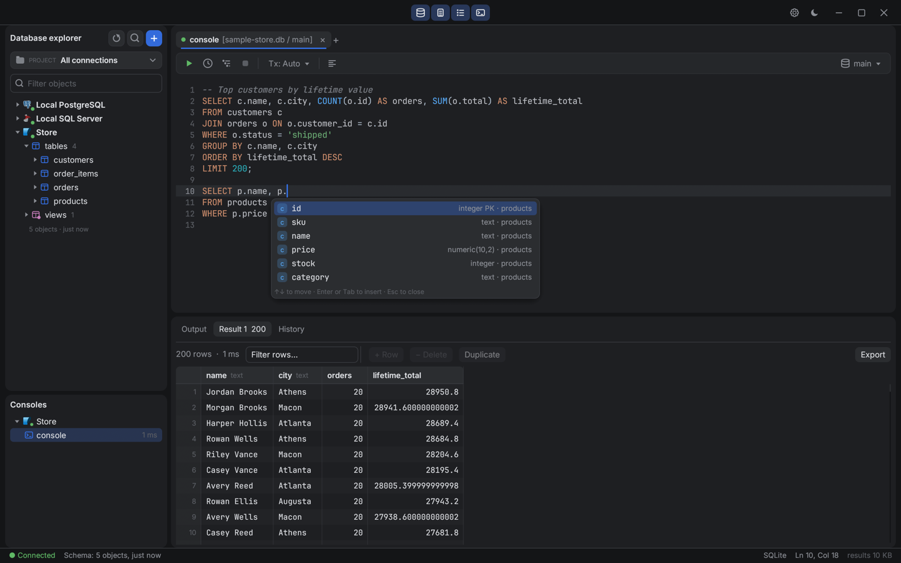
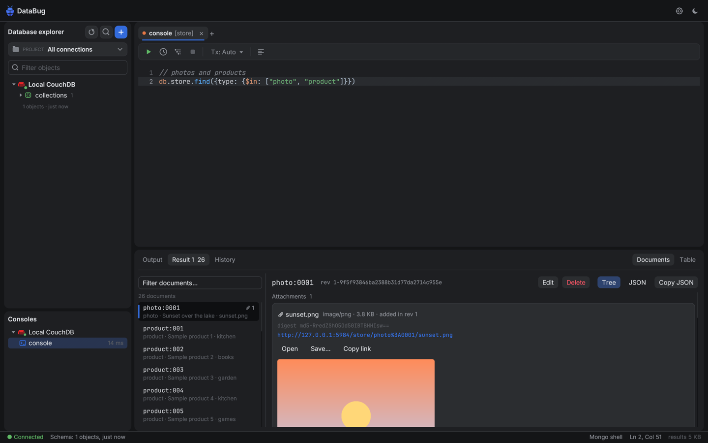
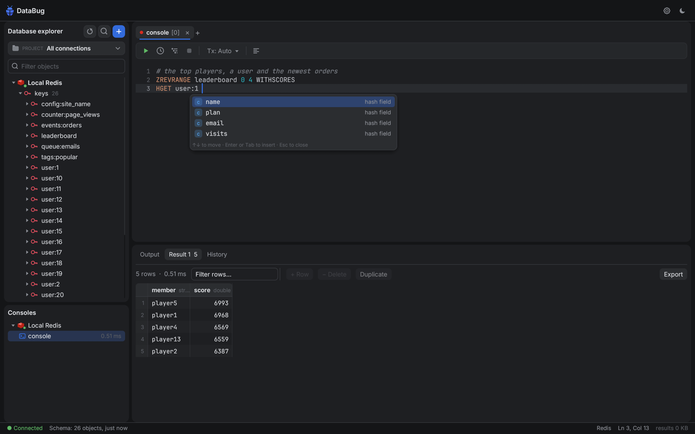
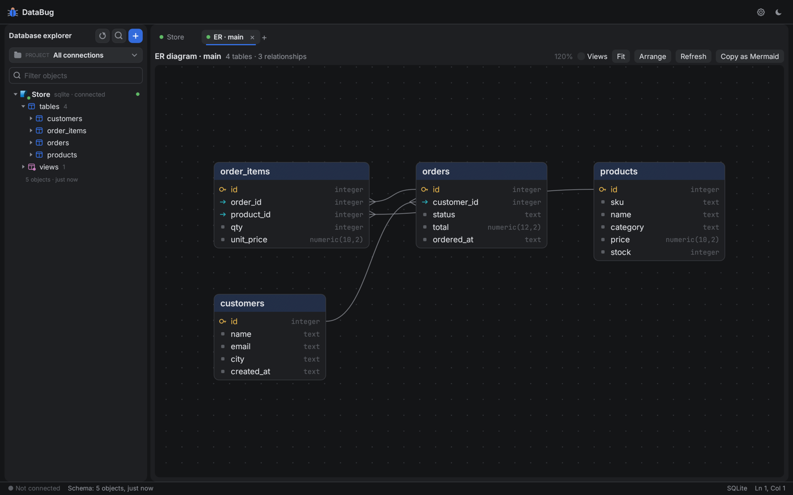

<p align="center">
  
</p>

<h1 align="center">DataBug</h1>

<p align="center">
  <b>A fast, native database client for SQL and NoSQL.</b><br>
  Free and open source for macOS, Windows and Linux.
</p>

<p align="center">
  <a href="https://github.com/hayes-roach/DataBug/actions/workflows/ci.yml"></a>
  <a href="https://github.com/hayes-roach/DataBug/releases/latest"></a>
  <a href="https://github.com/hayes-roach/DataBug/releases"></a>
  
  
  <a href="LICENSE"></a>
  <a href="https://github.com/hayes-roach/DataBug/stargazers"></a>
</p>

<p align="center">
  <a href="https://hayes-roach.github.io/DataBug/">Website</a> ·
  <a href="https://github.com/hayes-roach/DataBug/releases/latest">Download</a> ·
  <a href="docs/features.md">Features</a> ·
  <a href="docs/databases.md">Databases</a> ·
  <a href="CHANGELOG.md">Changelog</a>
</p>

<p align="center">
  
</p>

<table>
  <tr>
    <td width="33%"></td>
    <td width="33%"></td>
    <td width="33%"></td>
  </tr>
  <tr>
    <td align="center"><sub>Documents and attachments</sub></td>
    <td align="center"><sub>Redis, with key and field completion</sub></td>
    <td align="center"><sub>ER diagrams</sub></td>
  </tr>
</table>

<p align="center"><a href="https://hayes-roach.github.io/DataBug/#demo">▶ Watch the one-minute demo</a></p>

## Why DataBug

- **Native and light.** A real desktop app written in Rust. It starts fast and stays small.
- **SQL and NoSQL in one place.** Relational, document, key-value, wide-column, time-series and analytical databases.
- **An editor that knows your schema.** Completion for tables, columns and joins, go to definition, rename refactoring.
- **Tools you reach for.** Query plans, schema compare, ER diagrams, table editing, CSV import and a document view.
- **Safe with production.** Read-only and production connections, confirmations, and no sign-in retries that lock accounts.
- **Free, and it stays free.** Apache-2.0, for personal and commercial use.

## Install

**macOS and Linux**

```sh
curl -fsSL https://raw.githubusercontent.com/hayes-roach/DataBug/main/install.sh | sh
```

**Windows** (PowerShell)

```powershell
irm https://raw.githubusercontent.com/hayes-roach/DataBug/main/install.ps1 | iex
```

Or grab the `.dmg`, setup `.exe` or `.tar.gz` from the [latest release](https://github.com/hayes-roach/DataBug/releases/latest). DataBug updates itself; see [installing and updating](docs/install.md) for folders, uninstalling and the Windows SmartScreen prompt.

## Databases

| Kind | Engines |
|---|---|
| Relational | PostgreSQL · MySQL / MariaDB · SQL Server · SQLite · Oracle · IBM Db2 · H2 |
| Document | MongoDB · CouchDB |
| Key-value | Redis |
| Wide-column | Cassandra |
| Time series | TimescaleDB · QuestDB · InfluxDB |
| Analytical | DuckDB |
| Distributed | CockroachDB · Spark SQL |

Drivers, what's tested against live servers, and each console's language are in [docs/databases.md](docs/databases.md).

## Build from source

```sh
git clone https://github.com/hayes-roach/DataBug && cd DataBug
cargo run --release
```

Needs Rust 1.89+ and a C compiler. Tests, architecture and the screenshot harness are in [docs/development.md](docs/development.md).

## Documentation

- [Features](docs/features.md): everything DataBug does, and keyboard shortcuts
- [Databases](docs/databases.md): engines, drivers and console languages
- [Installing and updating](docs/install.md)
- [Development](docs/development.md): building, architecture and tests

## Contributing

Issues and pull requests are welcome. Start with [CONTRIBUTING.md](CONTRIBUTING.md), and please follow the [Code of Conduct](CODE_OF_CONDUCT.md). Report security problems privately as described in [SECURITY.md](SECURITY.md).

<a href="https://ko-fi.com/hroach"></a>

## License

[Apache-2.0](LICENSE). Free for personal and commercial use. DataBug is provided as is, without warranty, and isn't affiliated with any database vendor; see the [disclaimer](docs/disclaimer.md) and [NOTICE](NOTICE).
